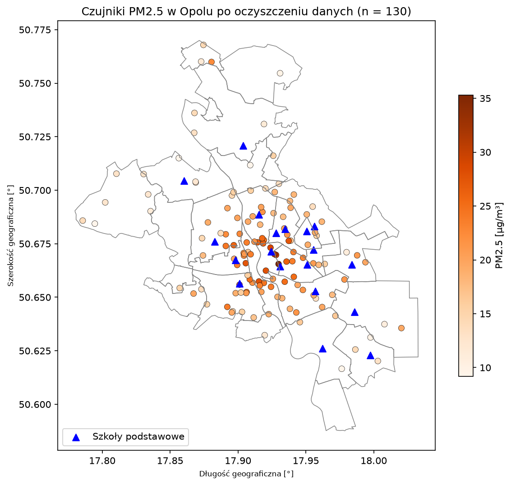
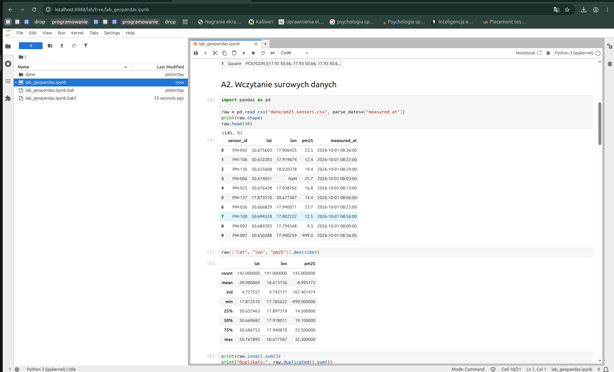
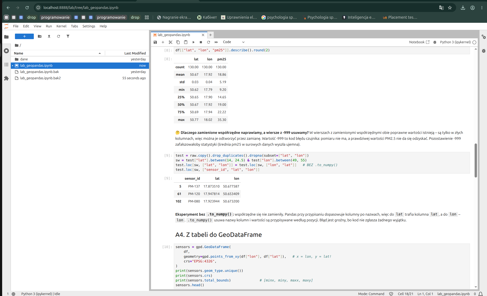
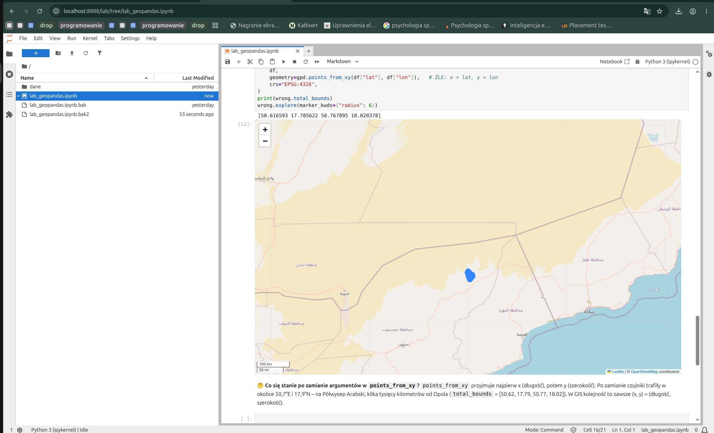

# LAB02 — Analiza danych wektorowych w GeoPandas (PM2.5, Opole)

**Przedmiot:** Analiza danych przestrzennych, Politechnika Opolska  
**Autor:** Andrii Zaluskyi, nr albumu 109585  
**Część zajęć:** A — GeoPandas (kroki A1–A4)

## Cel ćwiczenia

Przygotowanie surowych danych z czujników PM2.5 do analizy przestrzennej: wczytanie i kontrola jakości danych, oczyszczenie błędów, utworzenie obiektu `GeoDataFrame` z poprawnym układem współrzędnych oraz weryfikacja wyników na mapie.

## Zawartość katalogu

| Plik | Opis |
|---|---|
| `lab_geopandas.ipynb` | notatnik JupyterLab z krokami A1–A4, wynikami i odpowiedziami na pytania |
| `lab02_geopandas.py` | skrypt odtwarzający kroki A1–A4, sprawdzający punkty kontrolne i generujący mapy |
| `requirements.txt` | wymagane biblioteki |
| `dane/` | dane wejściowe |
| `images/` | mapy wygenerowane przez skrypt |

## Źródła danych

| Plik | Zawartość | Źródło |
|---|---|---|
| `dane/pm25_sensors.csv` | 145 odczytów PM2.5 (dane syntetyczne, celowo z błędami) | materiały prowadzącego |
| `dane/opole_districts.geojson` | granice 29 dzielnic Opola | © OpenStreetMap contributors, ODbL |
| `dane/opole_schools.geojson` | 19 szkół podstawowych w Opolu | © OpenStreetMap contributors, ODbL |

## Wykorzystane narzędzia

Python 3.14, GeoPandas 1.2.0, Shapely 2.2.0, pandas, matplotlib, folium, JupyterLab.

## Uruchomienie

```bash
pip install -r requirements.txt
python lab02_geopandas.py
```

Skrypt wypisuje wyniki kroków A1–A4, sprawdza je z punktami kontrolnymi instrukcji (`Punkty kontrolne: OK`) i zapisuje mapy w katalogu `images/`.

Notatnik: `jupyter lab lab_geopandas.ipynb`.

## Przebieg realizacji

1. **A1 — Geometria i GeoDataFrame:** obiekty `Point` i `Polygon` oraz tabela przestrzenna w EPSG:4326.
2. **A2 — Wczytanie danych:** kontrola jakości (`describe`, `isna`, `duplicated`).
3. **A3 — Czyszczenie danych:** usunięcie duplikatów i wierszy bez współrzędnych, naprawa zamienionych współrzędnych, usunięcie kodu błędu `-999`.
4. **A4 — GeoDataFrame:** geometria punktowa (`points_from_xy`, x = długość, y = szerokość) i podgląd na mapie.

### Kluczowe fragmenty kodu

Czyszczenie danych (A3):

```python
df = raw.drop_duplicates()
df = df.dropna(subset=["lat", "lon"])
swapped = df["lat"].between(14, 24.5) & df["lon"].between(49, 55)
df.loc[swapped, ["lat", "lon"]] = df.loc[swapped, ["lon", "lat"]].to_numpy()
df = df[df["pm25"] >= 0].reset_index(drop=True)
```

Utworzenie GeoDataFrame (A4):

```python
sensors = gpd.GeoDataFrame(
    df,
    geometry=gpd.points_from_xy(df["lon"], df["lat"]),   # x = długość, y = szerokość
    crs="EPSG:4326",
)
```

## Wyniki

| Etap | Liczba wierszy |
|---|---|
| Dane wejściowe | 145 |
| Po usunięciu duplikatów | 140 |
| Po usunięciu braków współrzędnych | 134 |
| Naprawione zamienione współrzędne | 3 (PM-137, PM-120, PM-080) |
| Po usunięciu kodu błędu -999 | **130** |

- Typ geometrii: `Point`, układ: `EPSG:4326`.
- `total_bounds` ≈ [17.79, 50.62, 18.02, 50.77] — wszystkie czujniki leżą w Opolu.
- Po oczyszczeniu: `lat` 50.62–50.77, `pm25` 9.2–35.3 µg/m³.

### Dokumentacja graficzna



Mapy interaktywne (do pobrania i otwarcia w przeglądarce):

- `images/mapa_czujniki.html` — czujniki po oczyszczeniu,
- `images/mapa_bledne_wspolrzedne.html` — skutek zamiany argumentów w `points_from_xy`.

## Wnioski

- Dane z zewnątrz trzeba najpierw obejrzeć: minimum `lat` ≈ 17,9 ujawniło wiersze z zamienionymi współrzędnymi.
- Zamienione współrzędne można odtworzyć, natomiast kodu `-999` nie — dlatego te wiersze usunięto.
- Zamiana kolumn bez `.to_numpy()` nie działa (pandas dopasowuje kolumny po nazwach) i nie zgłasza błędu.
- Zamiana argumentów w `points_from_xy` przenosi czujniki na Półwysep Arabski (`total_bounds` ≈ [50.62, 17.79, 50.77, 18.02]) — w GIS kolejność to zawsze (x, y) = (długość, szerokość).

## Zrzuty ekranu z notatnika

**A1 — geometria i GeoDataFrame**


**A2 — surowe dane i kontrola jakości** (min `lat` ≈ 17,87, min `pm25` = −999)



**A3 — czyszczenie danych** (145 → 140 → 134 → 130)


**A3 — dane po czyszczeniu i eksperyment bez `.to_numpy()`**



**A4 — czujniki na mapie Opola**


**A4 — skutek zamiany argumentów w `points_from_xy`** (czujniki w Jemenie, Półwysep Arabski)


