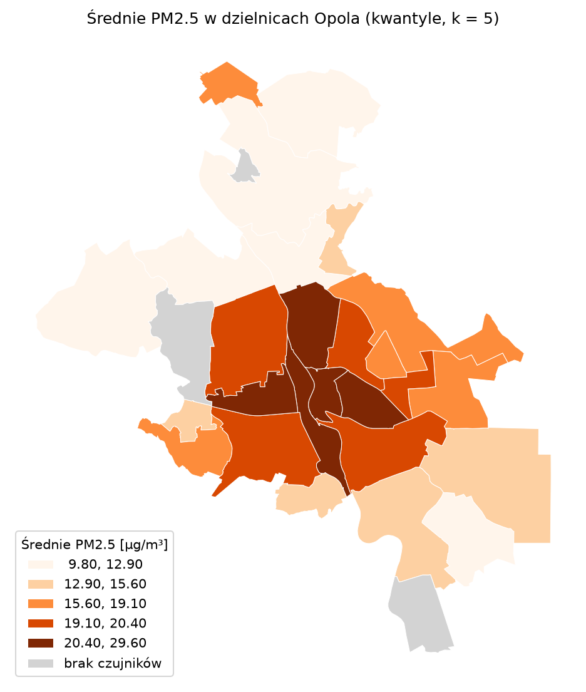
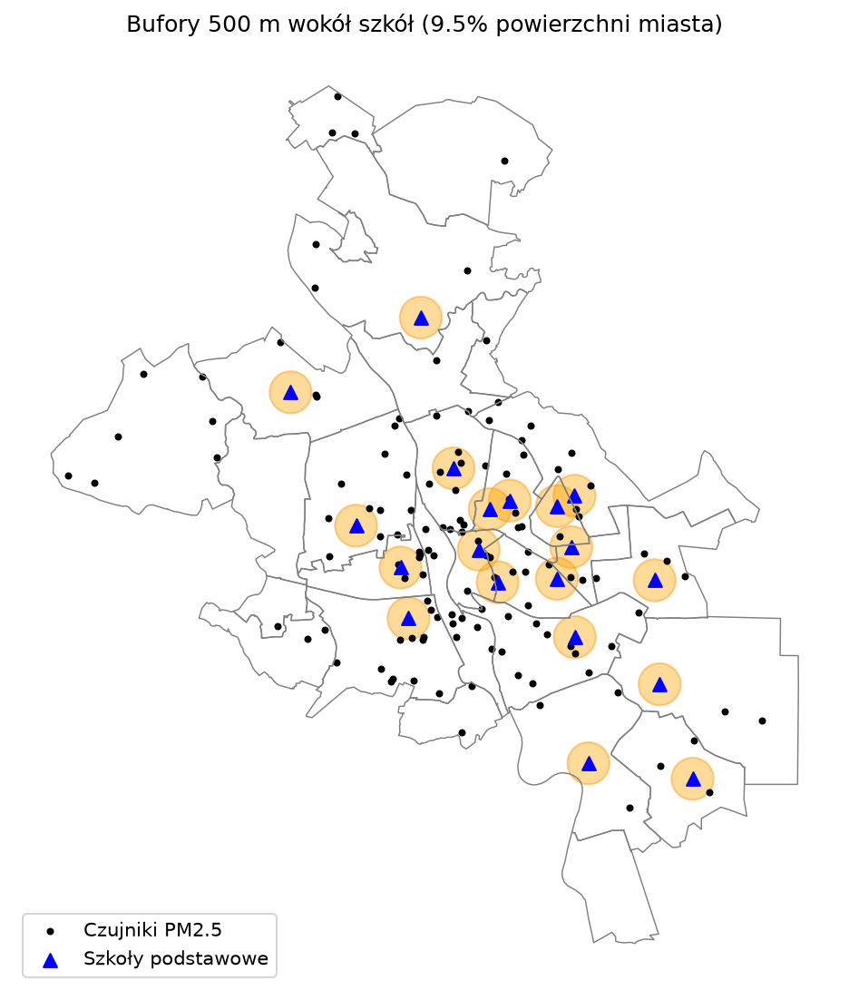
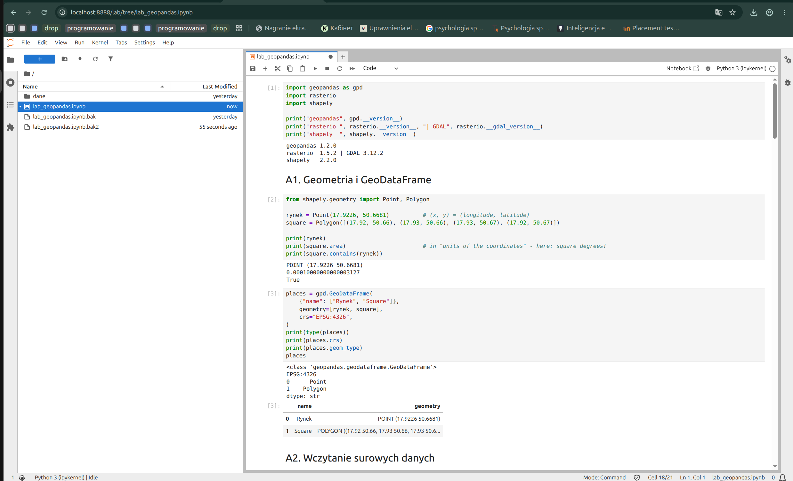
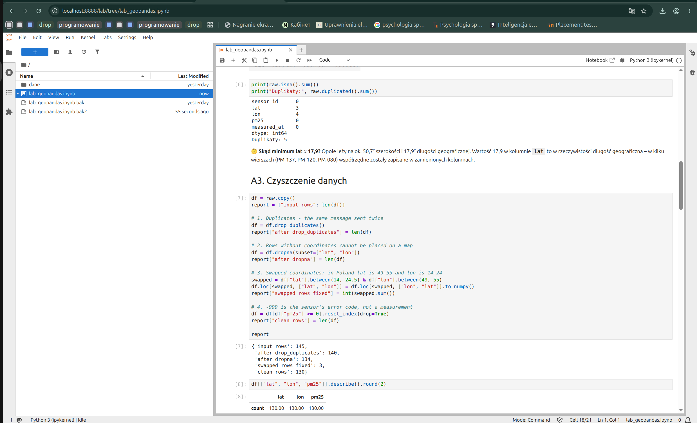
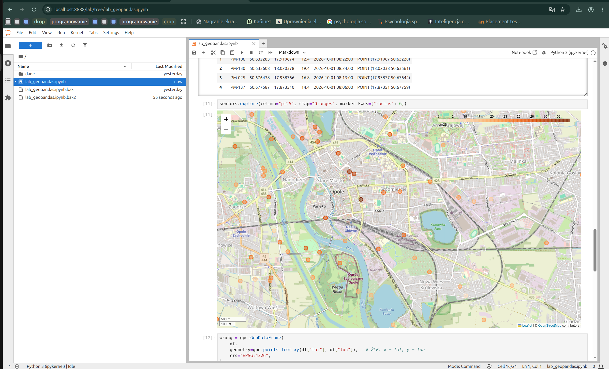
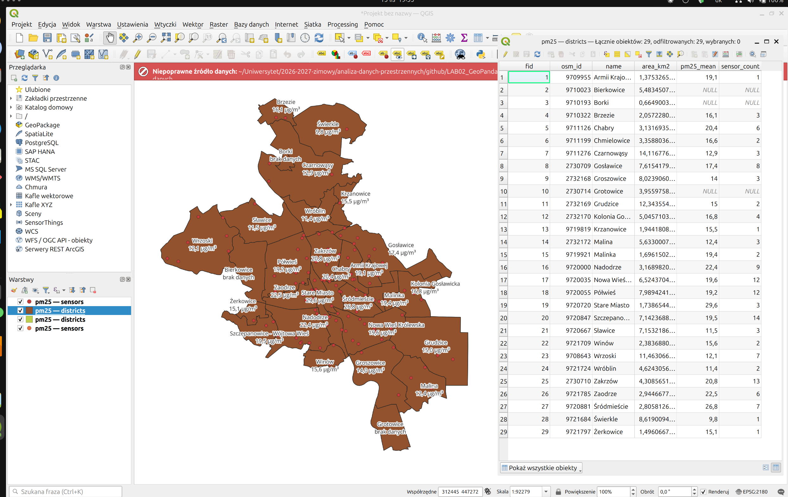

# LAB02 — Analiza danych wektorowych w GeoPandas (PM2.5, Opole)

**Przedmiot:** Analiza danych przestrzennych, Politechnika Opolska  
**Autor:** Andrii Zaluskyi, nr albumu 109585  
**Zakres:** część A — GeoPandas, kroki A1–A9

## Cel ćwiczenia

Na podstawie surowego pliku CSV z odczytami PM2.5 odpowiedzieć na dwa pytania:

1. Które dzielnice Opola mają najgorsze powietrze?
2. Jak wygląda sytuacja w pobliżu szkół podstawowych?

## Zawartość katalogu

| Plik | Opis |
|---|---|
| `lab_geopandas.ipynb` | notatnik JupyterLab: kroki A1–A9, wyniki, eksperymenty i odpowiedzi na pytania |
| `lab02_geopandas.py` | skrypt odtwarzający A1–A9, sprawdzający wszystkie punkty kontrolne i generujący mapy |
| `requirements.txt` | wymagane biblioteki |
| `dane/` | dane wejściowe |
| `wyniki/` | wyniki przestrzenne: `pm25.gpkg` (warstwy `districts`, `sensors`, EPSG:2180) i `pm25_districts.geojson` (EPSG:4326) |
| `images/` | mapy i zrzuty ekranu |

## Źródła danych

| Plik | Zawartość | Źródło |
|---|---|---|
| `dane/pm25_sensors.csv` | 145 odczytów PM2.5 (dane syntetyczne, celowo z błędami) | materiały prowadzącego |
| `dane/opole_districts.geojson` | granice 29 dzielnic Opola | © OpenStreetMap contributors, ODbL |
| `dane/opole_schools.geojson` | 19 szkół podstawowych w Opolu | © OpenStreetMap contributors, ODbL |

## Narzędzia

Python 3.14, GeoPandas 1.2.0, Shapely 2.2.0, pyproj, pandas, matplotlib, mapclassify, folium, JupyterLab.

## Uruchomienie

```bash
pip install -r requirements.txt
python lab02_geopandas.py          # A1–A9 + punkty kontrolne + mapy
jupyter lab lab_geopandas.ipynb    # notatnik
```

Skrypt kończy się komunikatem `Wszystkie punkty kontrolne A1–A9: OK`.

## Przebieg realizacji

| Krok | Zakres |
|---|---|
| A1 | geometrie `Point` / `Polygon` i `GeoDataFrame` w EPSG:4326 |
| A2 | wczytanie CSV i kontrola jakości (`describe`, `isna`, `duplicated`) |
| A3 | czyszczenie: duplikaty, braki współrzędnych, zamienione współrzędne, kod błędu `-999` |
| A4 | `GeoDataFrame` z `points_from_xy` (x = długość, y = szerokość) |
| A5 | porównanie układów EPSG:4326, EPSG:3857 i EPSG:2180 |
| A6 | dzielnice: przeliczenie do EPSG:2180 i powierzchnia |
| A7 | złączenie przestrzenne `sjoin` czujników z dzielnicami, średnie PM2.5, kartogram |
| A8 | bufory 500 m wokół szkół, pokrycie miasta |
| A9 | zapis do GeoPackage i GeoJSON, kontrola odczytu |

## Wyniki

**Czyszczenie danych (A3):** 145 → 140 (duplikaty) → 134 (braki współrzędnych), 3 naprawione wiersze z zamienionymi współrzędnymi (PM-137, PM-120, PM-080), **130** czujników po usunięciu kodu `-999`.

**Układy współrzędnych (A5):** odległość dwóch pierwszych czujników to 0,045° w EPSG:4326 i **4906 m** w EPSG:2180. Gdańsk–Zakopane:

| Układ | Odległość | Błąd |
|---|---|---|
| geodezyjna (elipsoida WGS84) | 569,3 km | — |
| EPSG:2180 (PUWG 1992) | 568,9 km | −0,07 % |
| EPSG:3857 (Web Mercator) | 922,8 km | +62 % |

**Dzielnice (A6):** 29 dzielnic, powierzchnia miasta **148,8 km²**; największa Czarnowąsy (14,1 km²), najmniejsza Borki (0,66 km²).

**Najgorsze powietrze (A7)** — dzielnice z co najmniej 3 czujnikami:

| Dzielnica | Średnie PM2.5 [µg/m³] | Liczba czujników |
|---|---|---|
| Stare Miasto | 29,6 | 3 |
| Śródmieście | 26,8 | 7 |
| Zaodrze | 22,5 | 6 |

Wszystkie 130 czujników przypisano do dzielnic; 3 dzielnice nie mają żadnego czujnika.

**Szkoły (A8):** 11 z 19 szkół ma czujnik w promieniu 500 m, średnie PM2.5 przy szkołach to **22,3 µg/m³**, a bufory 500 m pokrywają **9,5 %** powierzchni miasta. Przy promieniu 1500 m czujnik w pobliżu ma wszystkie 19 szkół.

**Zapis (A9):** `wyniki/pm25.gpkg` zawiera warstwy `districts` (29 obiektów, EPSG:2180) i `sensors`.

## Dokumentacja graficzna






Mapy interaktywne (do pobrania i otwarcia w przeglądarce): `images/mapa_czujniki.html`, `images/mapa_kartogram.html`, `images/mapa_bledne_wspolrzedne.html`.

### Zrzuty ekranu z notatnika

| Krok | Zrzut |
|---|---|
| A1 — geometria i GeoDataFrame |  |
| A2 — surowe dane |  |
| A3 — czyszczenie |  |
| A3 — eksperyment bez `.to_numpy()` |  |
| A4 — mapa czujników |  |
| A4 — zamienione argumenty `points_from_xy` |  |

## Wnioski

- Dane z zewnątrz trzeba najpierw obejrzeć: minimum `lat` ≈ 17,9 ujawniło wiersze z zamienionymi współrzędnymi. Zamienione współrzędne da się odtworzyć, kodu `-999` – nie.
- Kolejność współrzędnych w GIS to zawsze (x, y) = (długość, szerokość). Zamiana argumentów w `points_from_xy` przeniosła czujniki do wschodniego Jemenu, a kod nie zgłosił błędu.
- Odległości, powierzchnie i bufory trzeba liczyć w układzie metrycznym (w Polsce EPSG:2180). EPSG:3857 zawyża odległości o ok. 62 %, a `buffer(1500)` w EPSG:4326 tworzy „bufor” obejmujący całą Ziemię.
- Najwyższe średnie PM2.5 wystąpiły w centrum miasta: Stare Miasto, Śródmieście, Zaodrze.
- **Ograniczenia:** odczyty PM2.5 są syntetyczne, więc wyniki ilustrują metodę, a nie rzeczywistą jakość powietrza w Opolu. Średnie oparte są na 3–13 czujnikach na dzielnicę i jednym momencie pomiaru; 3 dzielnice nie mają danych.

## Weryfikacja wyników w QGIS (A9)

Plik `wyniki/pm25.gpkg` otwarto w QGIS 3.34. Obie warstwy (`districts`, `sensors`) wczytały się poprawnie w układzie EPSG:2180, a tabela atrybutów warstwy `districts` zawiera 29 obiektów z polami `pm25_mean` i `sensor_count`. Etykiety pokazują nazwę dzielnicy i średnie PM2.5; trzy dzielnice bez czujników (Bierkowice, Borki, Grotowice) oznaczono jako „brak danych”.

Wyrażenie etykiety: `"name" || '\n' || coalesce(format_number("pm25_mean", 1) || ' µg/m³', 'brak danych')`


