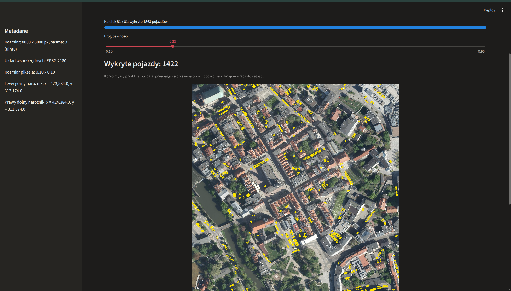

# LAB03 — Simple Cars Detector (wykrywanie samochodów na ortofotomapie)

**Przedmiot:** Analiza danych przestrzennych, Politechnika Opolska  
**Autor:** Andrii Zaluskyi, nr albumu 109585

## Cel ćwiczenia

Zbudowanie aplikacji webowej w Streamlit, która wczytuje ortofotomapę w formacie GeoTIFF, wykrywa na niej pojazdy gotowym modelem **YOLO11n-OBB** (trenowanym na zdjęciach lotniczych ze zbioru DOTA), zaznacza je na interaktywnym podglądzie i podaje ich położenie we współrzędnych mapy.

## Dane i narzędzia

| Element | Opis |
|---|---|
| `data/centrum_10cm.tif` | ortofotomapa centrum Opola od prowadzącego: 8000 × 8000 px, 3 pasma (uint8), EPSG:2180, piksel 0,10 × 0,10 m (plik nie jest dołączony do repozytorium) |
| `yolo11n-obb.pt` | model Ultralytics pobierany automatycznie przy pierwszym uruchomieniu (ok. 6 MB) |
| Biblioteki | Python 3.12, Streamlit 1.67, Ultralytics 8.4, PyTorch 2.15 (CUDA), rasterio 1.5, Plotly, pandas, Pillow |

## Uruchomienie

```bash
pip install -r requirements.txt
mkdir -p data   # umieść tu centrum_10cm.tif
streamlit run app.py
```

## Przebieg realizacji

| Etap | Zakres |
|---|---|
| B1 | strona Streamlit; skrypt wykonuje się od nowa przy każdej interakcji |
| B2 | wczytanie GeoTIFF z pamięci (`MemoryFile`), metadane, rozciągnięcie do uint8, interaktywny podgląd Plotly (obraz zmniejszony do 3000 px tylko do wyświetlania) |
| B2 — zadanie | narożniki obrazu w układzie mapy: lewy górny (423 584,0; 312 174,0), prawy dolny (424 384,0; 311 374,0) — obszar 800 × 800 m |
| B3 | model YOLO11n-OBB (`@st.cache_resource`), predykcja na całym obrazie naraz |
| B4 | podział na kafelki 1024 px z zakładką 128 px (81 kafelków), `agnostic_nms`, usuwanie duplikatów z zakładek, wyniki w `st.session_state`, ramki na podglądzie, suwak progu pewności, tabela ze współrzędnymi EPSG:2180 |

## Wyniki

| Wariant | Wykryte pojazdy |
|---|---|
| B3: cały obraz naraz (próg 0,25) | 46 small vehicle + 1 large vehicle |
| B4: kafelki 1024 px (próg 0,25) | **1422** (u autora instrukcji: 1423) |
| B4: kafelki, wszystkie wykrycia (próg 0,10) | 1563 |



## Wnioski

- Na całym obrazie naraz model wykrywa tylko kilkadziesiąt obiektów, bo skaluje obraz 8000 px do rozmiaru wejścia sieci — samochód o długości ok. 45 px (4,5 m / 0,1 m) zmienia się w plamkę 5–6 px. Podział na kafelki w natywnej rozdzielczości zwiększa liczbę wykryć ok. 30-krotnie.
- Zakładka kafelków (128 px) zapobiega ucinaniu samochodów na granicach, a reguła „środek w wewnętrznej części kafelka” usuwa duplikaty.
- `st.session_state` przechowuje wyniki między uruchomieniami skryptu, więc zmiana progu pewności filtruje gotową listę bez ponownego uruchamiania modelu.
- Georeferencja (transformacja afiniczna) pozwala przeliczyć środek każdej ramki z pikseli na współrzędne PL-1992 z dokładnością centymetrową (obliczenia w float64).
- **Ograniczenia:** model jest ogólny (DOTA), nie trenowany na Opolu; przy niskim progu pojawiają się fałszywe wykrycia (dachy, kontenery), a przy wysokim część aut w cieniu lub pod drzewami jest pomijana. Liczby nie były weryfikowane ręcznym liczeniem.
